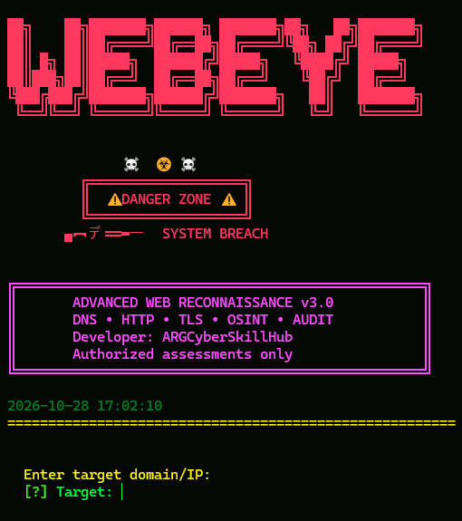

# ☠️ WebEye — Advanced Web Reconnaissance

<p align="center">
  <strong>DNS • HTTP • TLS • OSINT • Security Audit</strong>
</p>

WebEye is a Python-based website reconnaissance and basic security-auditing tool designed for authorized security assessments and educational labs.


<h2 align="center">📸 WebEye Screenshots</h2>

<p align="center">
  
</p>

## ✨ Features

- DNS record lookup
- Basic TCP port checks
- HTTP response and header inspection
- TLS/SSL certificate analysis
- Website technology detection
- Security-header audit
- Subdomain checks using a predefined list
- WHOIS lookup
- Public email-address extraction
- Social media link discovery
- `robots.txt` and sitemap inspection
- Basic IP geolocation lookup
- Website response-time check
- Target summary and report generation
- Optional website screenshot support, if configured in the code

## 🧰 Requirements

- Python 3.10 or newer recommended
- Git (optional, for cloning the repository)
- Internet connection
- Windows 10/11, Kali Linux, or another compatible Linux distribution

## 📁 Project Structure

```text
WebEye/
├── webeye.py
├── requirements.txt
├── README.md
├── .gitignore
└── LICENSE
```

## 🪟 Installation on Windows

### 1. Install Python

Install Python from:

https://www.python.org/downloads/

During installation, enable **Add Python to PATH**.

Verify the installation:

```powershell
py --version
py -m pip --version
```

### 2. Open the project folder

If you have already downloaded the project:

```powershell
cd "$HOME\Desktop\WebEye"
```

If you are cloning it from GitHub:

```powershell
git clone https://github.com/argcyberskillhub/WebEye.git
cd WebEye
```


### 3. Create a virtual environment

```powershell
py -m venv .venv
```

Activate it:

```powershell
.\.venv\Scripts\Activate.ps1
```

If PowerShell blocks activation, use this for the current terminal session only:

```powershell
Set-ExecutionPolicy -Scope Process -ExecutionPolicy Bypass
.\.venv\Scripts\Activate.ps1
```

### 4. Install dependencies

```powershell
python -m pip install --upgrade pip
python -m pip install -r requirements.txt
```

### 5. Run WebEye

```powershell
python webeye.py
```

---

## 🐉 Installation on Kali Linux

### 1. Update package lists

```bash
sudo apt update
```

### 2. Install system dependencies

```bash
sudo apt install -y python3 python3-pip python3-venv git
```

### 3. Download the repository

```bash
cd ~/Desktop
git clone https://github.com/argcyberskillhub/WebEye.git
cd WebEye
```

If the project already exists locally, navigate to its directory instead.

### 4. Create a virtual environment

```bash
python3 -m venv .venv
```

Activate it:

```bash
source .venv/bin/activate
```

### 5. Install Python requirements

```bash
python -m pip install --upgrade pip
python -m pip install -r requirements.txt
```

### 6. Launch WebEye

```bash
python3 webeye.py
```

To leave the virtual environment:

```bash
deactivate
```

---

## 📦 requirements.txt

The repository's `requirements.txt` contains the Python packages needed by the current script. Keep it synchronized with the imports actually used in `webeye.py`.

Example dependencies:

```text
requests>=2.32.0,<3.0
dnspython>=2.6.0,<3.0
python-whois>=0.9.0,<1.0
colorama>=0.4.6,<1.0
beautifulsoup4>=4.12.0,<5.0
```

Only add other packages if the corresponding feature is implemented and requires them.

## 🚀 Usage

Start the application:

```bash
python webeye.py
```

On Kali Linux, `python3 webeye.py` can also be used.

Follow the on-screen menu and enter the requested target. Choose a module using its displayed number.

Depending on the current version of the script, available actions may include:

- Run an individual reconnaissance module
- Run all available modules
- View collected results
- Save a report
- Exit the application

**Note:** The exact menu numbers and available actions depend on the version of `webeye.py` in the repository.

## 📄 Reports

If report saving is enabled, WebEye can save collected results to files in the format supported by the current script.


## 🔐 Responsible Use

- Scan only websites and systems you own or have explicit permission to assess.
- Respect applicable laws, terms of service, and rate limits.
- Do not use this tool to disrupt services or access private data.
- Publicly accessible information is not automatically authorized for every type of testing.
- Obtain written authorization before conducting assessments for clients or organizations.

The author is not responsible for misuse of this software.

## 🛠️ Troubleshooting

### Python is not recognized on Windows

Try:

```powershell
py --version
```

If this also fails, install Python and enable PATH integration.

### `ModuleNotFoundError`

Activate your virtual environment and reinstall dependencies:

```bash
python -m pip install -r requirements.txt
```

### Kali Linux reports an externally managed environment

Use a virtual environment as shown above. Avoid using `sudo pip install` or forcing system-wide package installation.

### DNS or network requests fail

Check your internet connection, DNS configuration, firewall, and target availability. Some servers block automated requests or limit responses.

## 🤝 Contributing

Contributions, bug reports, and suggestions are welcome.

1. Fork the repository.
2. Create a feature branch.
3. Test your changes.
4. Submit a pull request.

## 📜 License

This project is distributed under the license included in the repository. Check the `LICENSE` file for the applicable terms.

---

**Developed by ARG Cyber Skill Hub**

*Learn Today • Secure Tomorrow*
